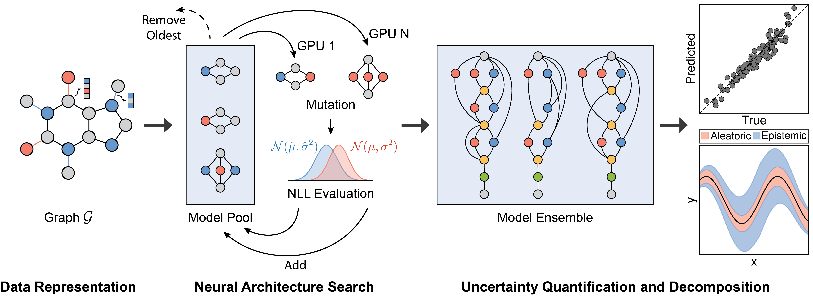

# Uncertainty Quantification for Molecular Property Predictions with Graph Neural Architecture Search

## ✨ Introduction
Graph Neural Networks (GNNs) have emerged as a prominent class of data-driven methods for molecular property prediction. However, a key limitation of typical GNN models is their inability to quantify uncertainties in the predictions. This capability is crucial for ensuring the trustworthy use and deployment of models in downstream tasks. To that end, we introduce AutoGNNUQ, an automated uncertainty quantification (UQ) approach for molecular property prediction. AutoGNNUQ leverages architecture search to generate an ensemble of high-performing GNNs, enabling the estimation of predictive uncertainties. Our approach employs variance decomposition to separate data (aleatoric) and model (epistemic) uncertainties, providing valuable insights for reducing them. In our computational experiments, we demonstrate that AutoGNNUQ outperforms existing UQ methods in terms of both prediction accuracy and UQ performance on multiple benchmark datasets. Additionally, we utilize t-SNE visualization to explore correlations between molecular features and uncertainty, offering insight for dataset improvement. AutoGNNUQ has broad applicability in domains such as drug discovery and materials science, where accurate uncertainty quantification is crucial for decision-making.
<br />

> Presentation

- 👉 [AIChE](https://drive.google.com/file/d/1DFC_-jh8x_qYjCub839b4cb4Fi4IlT6n/view?usp=sharing)

> Paper

- 👉 [arXiv](https://doi.org/10.48550/arXiv.2307.10438)


<br /> 

## ✨ AUTOGNNUQ Overview
<br />

<br />

## ✨ Implementation and Development

### Download Data
The necessary data can be found in the `data` folder. It includes the csv files for Lipo, FreeSolv, ESOL, and QM7 datasets from Deepchem.

Download the folder from the git repository and install it as a pip package with the editable option.
```bash
$ git clone -b AUTOGNNUQ --single-branch https://github.com/zavalab/ML.git
$ cd ML/AUTOGNNUQ
$ pip install -e .
```

The trained weights are available [here](https://drive.google.com/drive/folders/19CH9L3GL6_yWj1qAl411GBIO7-mxb_f7?usp=sharing).

### Install Packages
```bash
python = 3.8
deephyper = 0.3.3
tensorflow = 2.5.0
tensorflow-probability = 0.13.0
ray = 2.0.1
```
This package heavily relies on DeepHyper. Detailed documentation and installation tutorials for different machines can be found at [https://deephyper.readthedocs.io/en/latest/index.html](https://deephyper.readthedocs.io/en/latest/index.html).

### Folder Structure
- The `data` folder includes all raw data files in CSV format, containing SMILES strings and properties.
- The `gnn_uq` folder contains all Python files used for neural architecture search (NAS), post-training analysis, and result analysis.
- The `notebook` folder contains three Jupyter Notebooks for the results of NAS, UQ, and tSNE, respectively.
- The `result` folder contains pickle files with all the results. Instructions on how to load them can be found in the notebooks.

### How to Train

- `python gnn_uq/train.py` runs neural architecture search for uncertainty quantification using multi-GPU support.
- `python gnn_uq/post_training.py` executes post-training with the top 10 architectures discovered.
- `python gnn_uq/post_training_random.py` executes post-training with random 10 architectures discovered.

To run NAS training with multiple GPUs, submit the following Slurm script on your server.

```bash
#!/bin/bash
#SBATCH --job-name=some.name
#SBATCH --output=some.out
#SBATCH --error=some.err
#SBATCH --nodes=1                
#SBATCH --ntasks=1             
#SBATCH --cpus-per-gpu=1         
#SBATCH --mem-per-cpu=32G
#SBATCH --gres=gpu:32
#SBATCH --time=24:00:00

export TRAIN="/some/dir/autognnuq/gnn_uq/train.py"

conda activate your.python.env

srun python $TRAIN
```

## Reference
This code accompanies the paper:

Shengli Jiang, Shiyi Qin, Reid C. Van Lehn, Prasanna Balaprakash, and Victor M. Zavala. "Uncertainty quantification for molecular property predictions with graph neural architecture search." *Digital Discovery* 3, no. 8 (2024): 1534-1553. https://doi.org/10.1039/d4dd00088a

Preprint: https://arxiv.org/abs/2307.10438

## BibTeX
```bibtex
@article{jiang2024uncertainty,
  title   = {{Uncertainty quantification for molecular property predictions with graph neural architecture search}},
  author  = {Jiang, Shengli and Qin, Shiyi and Van Lehn, Reid C. and Balaprakash, Prasanna and Zavala, Victor M.},
  journal = {Digital Discovery},
  volume  = {3},
  number  = {8},
  pages   = {1534--1553},
  year    = {2024},
  doi     = {10.1039/d4dd00088a}
}
```

## Authors
Shengli Jiang, Shiyi Qin, Reid C. Van Lehn, Prasanna Balaprakash, and Victor M. Zavala
