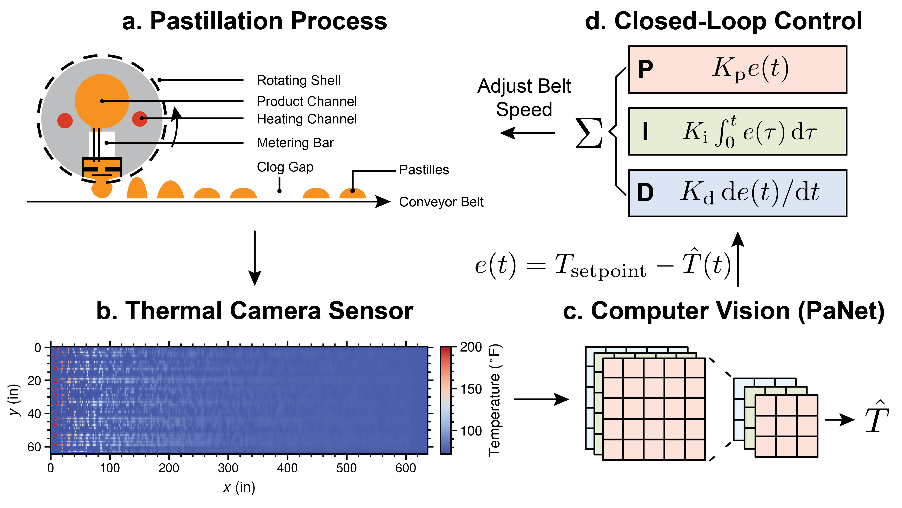

# PasNet
A Digital Twin Simulator of a Pastillation Process for Feedback Control based on Computer Vision



## Project Structure
```
Pastillation/
├── notebook/
│   ├── result.ipynb        # Results and figures
│   └── control.ipynb      # Feedback control examples
├── submit/           
│   ├── gen_data.submit    # Generate simulation data
│   └── train_cnn.submit   # Train vision model
├── pastillation/             
│   ├── analysis/          # Training analysis
│   ├── data/             # Data generation
│   └── model/            # Vision models
└── setup.py              # Package installer
```

## Installation
```bash
cd Pastillation
pip install -e .
```

## Usage
For HPC clusters:
```bash
cd submit
sbatch gen_data.submit    # Generate videos
sbatch train_cnn.submit   # Train model
```

For local development:
1. Set `idx = 0` and `max_idx = 1` in the following files
2. Run:
```bash
python pastillation/data/gen_data.py    # Generate data
python pastillation/model/train_cnn.py   # Train model
```

## Reference
This code accompanies the paper:

Leonardo D. González, Joshua L. Pulsipher, Shengli Jiang, Angan Mukherjee, Tyler Soderstrom, and Victor M. Zavala. "A digital twin simulator of a pastillation process with applications to automatic control based on computer vision." *Computers & Chemical Engineering* 201 (2025): 109205. https://doi.org/10.1016/j.compchemeng.2025.109205

Preprint: https://arxiv.org/abs/2503.16539

## BibTeX
```bibtex
@article{gonzalez2025digital,
  title   = {{A digital twin simulator of a pastillation process with applications to automatic control based on computer vision}},
  author  = {González, Leonardo D. and Pulsipher, Joshua L. and Jiang, Shengli and Mukherjee, Angan and Soderstrom, Tyler and Zavala, Victor M.},
  journal = {Computers \& Chemical Engineering},
  volume  = {201},
  pages   = {109205},
  year    = {2025},
  doi     = {10.1016/j.compchemeng.2025.109205}
}
```

## Authors
Leonardo D. González, Joshua L. Pulsipher, Shengli Jiang, Angan Mukherjee, Tyler Soderstrom, and Victor M. Zavala
