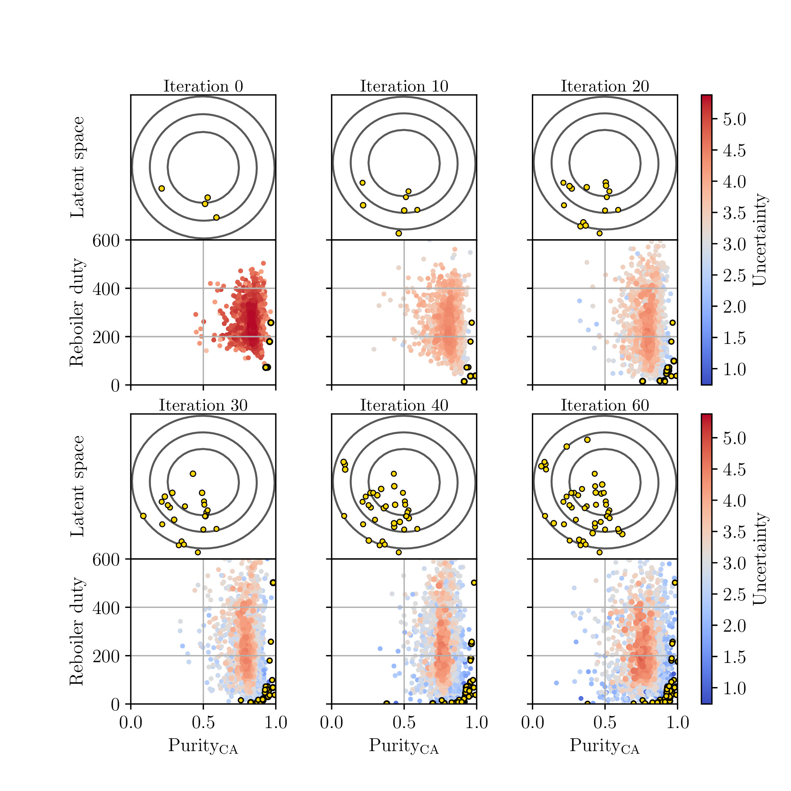
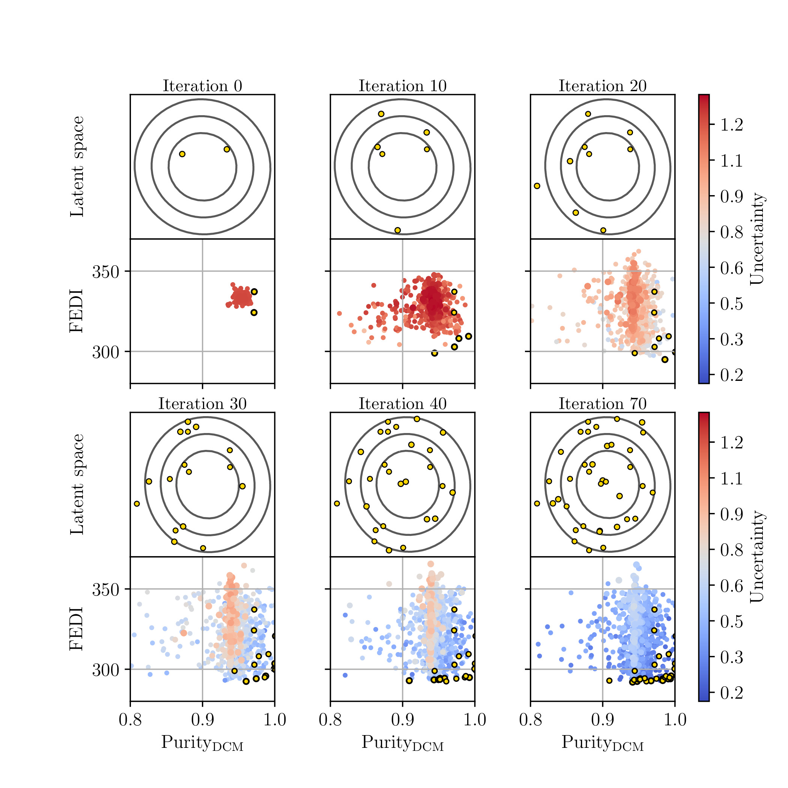

# bayesianvae

Variational autoencoders that project discrete decision spaces to continuous latent spaces for Bayesian optimization: reactor, caprylic acid extraction, and dividing wall column case studies.

This repository comprises scripts used in the research paper titled 
'Simulation-Based Optimization over Discrete Spaces using Projection to Continuous Latent Spaces'.


## Introduction

This repositorie contains the Jupyter Notebooks to train a Variational AutoEncoder using a k-fold validation with the Optuna framework. Also, three additional Jupyter Notebooks show how to couple this model with Bayesian Optimization for single and multiobjective problems. The cases studies involve a simple reactor CSTR, the recovery of caprylic acid from water by liquid-liquid extraction, and the extraction of dichloromethane using a intensified column know as dividing wall column. 

<br />

With this, we provide a simulation-based optimization framework to optimize over discrete spaces using the simulator Aspen Plus. In this code is also shared the simulations and the metodology to conect Python with Aspen. 

> Publication

- [In Progress]
<br />

<!-- ## Sample Output

>   Evolution of the Gaussian Process models and Pareto frontier along the BO search for the caprylic acid recovery.

<p align="center">
 
</p>

> Evolution of the Gaussian Process models and Pareto frontier along the BO search for the caprylic acid recovery.

<p align="center">
 
</p> -->

## Tutorials

For detailed usage, navigate to the `Jupyter Notebooks` directory.

## Software Versions

- numpy  1.26.4
- pandas 2.2.3
- matplotlib 3.10.1
- botorch 0.11.0
- pytorch 2.2.1+cpu 
- pymoo  0.6.1.1

## Links

- [Scalable Systems Lab](https://zavalab.engr.wisc.edu/)

<br />

## Reference
This code accompanies the paper:

Gabriel Hernández-Morales, Brenda Cansino-Loeza, Arturo Jiménez-Gutiérrez, and Victor M. Zavala. "Simulation-Based Optimization over Discrete Spaces Using Projection to Continuous Latent Spaces." *Industrial & Engineering Chemistry Research* 65, no. 7 (2026): 3999-4012. https://doi.org/10.1021/acs.iecr.5c04315

Preprint: https://arxiv.org/abs/2510.14206

## BibTeX
```bibtex
@article{hernandezmorales2026simulation,
  title   = {{Simulation-Based Optimization over Discrete Spaces Using Projection to Continuous Latent Spaces}},
  author  = {Hernández-Morales, Gabriel and Cansino-Loeza, Brenda and Jiménez-Gutiérrez, Arturo and Zavala, Victor M.},
  journal = {Industrial \& Engineering Chemistry Research},
  volume  = {65},
  number  = {7},
  pages   = {3999--4012},
  year    = {2026},
  doi     = {10.1021/acs.iecr.5c04315}
}
```

## Authors
Gabriel Hernández-Morales, Brenda Cansino-Loeza, Arturo Jiménez-Gutiérrez, and Victor M. Zavala
